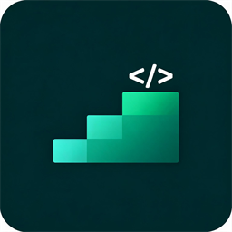
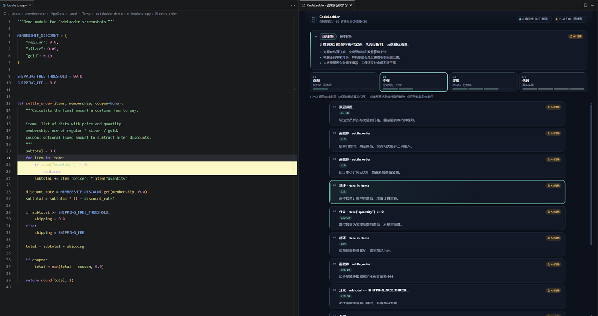
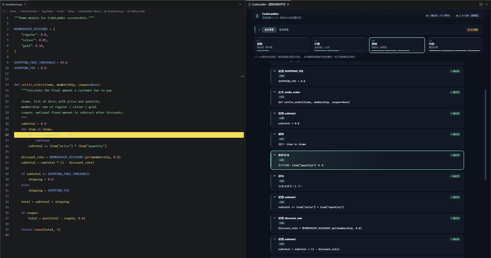
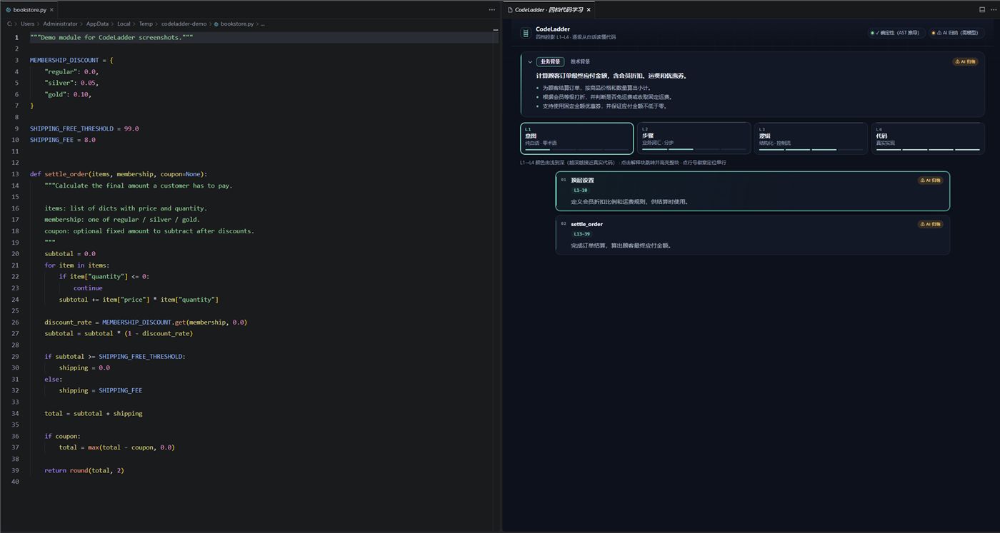
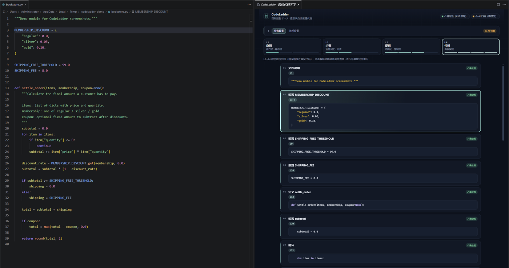

# CodeLadder _(codeladder)_



[](https://github.com/RichardLitt/standard-readme)
[](LICENSE)
[](https://code.visualstudio.com)

Explains a file in four connected tiers — intent, steps, logic, code — so you can understand code you didn't write.

CodeLadder is an editor extension that explains one file at a time. Each explanation is split into four tiers that zoom in from "what this function is for" to "the exact lines that do it". Every tier points back to real line ranges, so you can move between the explanation and the code in both directions instead of scrolling through a chat log.

Works with **Python, TypeScript, C, C++, Java, Rust and Go**.

## Table of Contents

- [Background](#background)
- [Screenshots](#screenshots)
- [Install](#install)
- [Usage](#usage)
- [The four tiers](#the-four-tiers)
- [Settings](#settings)
- [Supported languages](#supported-languages)
- [How it works](#how-it-works)
- [Privacy](#privacy)
- [Troubleshooting](#troubleshooting)
- [Changelog](#changelog)
- [Maintainer](#maintainer)
- [Contributing](#contributing)
- [License](#license)

## Background

Two groups of people read code they did not write:

- **AI-assisted developers who ship code they cannot fully read.** Vibe coding gets you working software fast. CodeLadder lets you climb back into the black box you merged, tier by tier, before you touch it again.
- **Anyone learning an unfamiliar codebase.** New hires, students, reviewers and maintainers start from the file's intent and walk down to individual statements, without reading every line first.

Most "explain this code" tools return one long answer in a chat window, disconnected from the file. CodeLadder keeps the explanation and the code side by side. Its design follows five rules:

- **Four tiers, one source of truth.** Every tier points back to real line ranges in the file.
- **Project-aware.** Before explaining a file, CodeLadder reads the project index: what the file defines, what it imports, and who imports it.
- **Deterministic first.** Structure comes from the syntax tree, not from a model. AI is optional and only rewrites the wording.
- **Click to jump, move to follow.** Click a block on the right to select the code on the left; move the cursor on the left to highlight the matching block.
- **Bilingual.** Chinese and English, switchable at runtime.

## Screenshots

The panel follows your editor language; these were taken in Trae with the Chinese UI. The badge on every block says where it came from — **✓ deterministic** means it was read off the syntax tree, **⚠ AI-inferred** means a model wrote the wording.

| Business context and L2 steps | L3 logic, with the code highlighted on the left |
| --- | --- |
|  |  |

| L2 with business context | L4 code, blocks mapped to line ranges |
| --- | --- |
|  |  |

## Install

| IDE | How to install |
| --- | --- |
| **VS Code** | Extensions view → search `CodeLadder`, or run the command below |
| **Trae** | Extensions view → search `CodeLadder`; if Trae's curated gallery does not list it yet, install the VSIX from the [latest release](https://github.com/white8tterfly/codeladder/releases/latest), or follow Trae's guide for installing an extension from the VS Code Marketplace |
| **Qoder** | Extensions view → `...` → **Install from VSIX**, or run the VSIX command below |
| **Other VS Code-compatible IDEs** | Download `codeladder-<version>.vsix` from the releases page and install it from the Extensions view |

```sh
# VS Code Marketplace
code --install-extension codeladder.codeladder

# Any VS Code-compatible IDE, from a downloaded release asset
code --install-extension codeladder-<version>.vsix
trae-cn --install-extension codeladder-<version>.vsix
```

### Requirements

- VS Code 1.85 or newer, or a compatible IDE such as Trae or Qoder.
- A language model exposed by the IDE, or an OpenAI-compatible endpoint configured in settings. Business context and the L1/L2 tiers cannot be generated without one.
- No Python, Java, Rust or Go toolchain is required — grammars are bundled with the extension.

## Usage

1. Open a folder in VS Code or Trae. The folder becomes the project CodeLadder reads.
2. Open any supported source file, for example `service.py` or `payment.java`.
3. Run **CodeLadder: Generate Four Tiers** from the Command Palette (`Ctrl+Shift+P` / `Cmd+Shift+P`), the editor title bar, or the editor right-click menu.
4. Switch between **L1 Intent**, **L2 Steps**, **L3 Logic** and **L4 Code** in the panel tab bar.
5. Click any explanation block to jump to and highlight its code. Move the cursor in the editor to see the matching block light up.
6. Check the header for the token count of the current file, and click **Re-analyze** to ignore the cache and regenerate every L1 / L2 explanation.

### Auto-refresh

Set `codeLadder.autoRefresh.enabled` to `true` to re-run the analysis whenever you save the file shown in the panel. The run is debounced, reuses unchanged groups and sends only the changed ones to the model. The token counter keeps adding up across these runs, so it always shows what the current file has cost so far instead of dropping back to zero; open another file to reset it. Use `codeLadder.autoRefresh.globs` to limit auto-refresh to matching paths.

Point CodeLadder at an OpenAI-compatible endpoint, and that endpoint takes precedence over anything the IDE offers:

```json
{
  "codeLadder.llm.baseUrl": "https://api.deepseek.com",
  "codeLadder.llm.apiKey": "sk-...",
  "codeLadder.llm.model": "deepseek-chat",
  "codeLadder.language": "auto"
}
```

The base URL is domain-level: CodeLadder appends `/chat/completions` itself. See [Settings](#settings) for every option. With no `baseUrl`, `apiKey` and `model` at all, CodeLadder falls back to a model the IDE exposes through `vscode.lm` — a Copilot Chat model, for example — and needs no key.

### Commands

| Command | ID | Description |
| --- | --- | --- |
| **CodeLadder: Generate Four Tiers** | `codeReadable.explain` | Parse the active file and open the four-tier panel |
| **CodeLadder: Regenerate** | `codeReadable.refresh` | Re-run the explanation for the active file |
| **CodeLadder: Rebuild Project Index** | `codeReadable.rebuildIndex` | Rescan the workspace and rebuild the project index |

The index also updates automatically when a supported file is saved.

## The four tiers

| Tier | Name | What you read | Where it comes from |
| --- | --- | --- | --- |
| **L1** | Intent | One explanation per function / interface / class, plus top-level segments (imports, setup, `__main__` startup) so every code line is covered | Model-written (a model is required) |
| **L2** | Steps | One explanation per code block (function body, branch, loop, module level), not per line | Model-written (a model is required) |
| **L3** | Logic | The structural shape: function signature, condition, loop source, return value, call expression | Syntax tree only, no guessing |
| **L4** | Code | The original code snippet with line badges | The source file itself |

Every semantic unit — a function, class, loop, branch, assignment, call, import or comment — becomes a block in all four tiers. The tiers are not separate summaries; they are four zoom levels of the same unit.

Each block carries a fidelity badge, so you always know how the text was produced:

| Badge | Meaning |
| --- | --- |
| **✓ Deterministic** | Produced entirely from the syntax tree and project index |
| **⚠ Inferred** | Unit and line range are known, but no model text has been applied (shown while L1/L2 wait for a model) |
| **⚠ AI-written** | Wording was written by your configured model; structure and line ranges remain deterministic |

### Project context

When a file belongs to a project, CodeLadder scans the workspace first and reports:

- the module name and file role,
- the classes and functions the file defines,
- the modules it imports,
- the files that import it, and which names they use,
- whether the file contains a program entry (`main`, `if __name__ == "__main__"`, and so on).

The context card at the top of the panel summarizes this, so the explanation is grounded in how the file is actually used, not just what it looks like in isolation. Click the card to collapse it; the panel remembers the state.

### Two-way highlighting

- Click a block on the right: the matching lines are selected and highlighted on the left, even when the file is in another editor tab.
- Move the cursor on the left: the corresponding block is focused on the right.
- Multi-line units highlight every line they cover.

## Settings

| Setting | Default | Description |
| --- | --- | --- |
| `codeLadder.language` | `auto` | Explanation and panel language: `auto` (follow the IDE display language), `zh`, `en` |
| `codeLadder.llm.baseUrl` | empty | OpenAI-compatible base URL at domain level, e.g. `https://api.deepseek.com` — CodeLadder appends `/chat/completions` itself |
| `codeLadder.llm.apiKey` | empty | API key for the model endpoint |
| `codeLadder.llm.model` | empty | Model name, e.g. `deepseek-chat` |
| `codeLadder.llm.maxInputChars` | `24000` | Maximum code characters sent per request (minimum 2000); overflow is left for the next run |
| `codeLadder.autoRefresh.enabled` | `false` | Re-run the analysis when the file shown in the panel is saved |
| `codeLadder.autoRefresh.globs` | empty | Glob patterns that limit auto-refresh, e.g. `src/**/*.py`; empty applies to every supported file |
| `codeLadder.highlight.color` | empty | Background of the hover highlight on the code side. Any CSS color, e.g. `rgba(250,204,21,0.18)`; empty follows the theme |
| `codeLadder.highlight.pinColor` | empty | Background of the strong highlight after clicking a block or line badge. Any CSS color; empty follows the theme, and the color is also used for the left accent border |

Highlight colors adapt to the active theme: light themes keep the pale yellow / bright yellow pair, while dark themes use a low-opacity amber so a full highlighted line is no longer glaring. Both layers can be overridden with `codeLadder.highlight.color` and `codeLadder.highlight.pinColor`.

The panel, tier names, project context and generated explanation all follow `codeLadder.language`. Changing the setting while the panel is open regenerates the current file in the new language.

## Supported languages

| Language | File types | Extracted structure |
| --- | --- | --- |
| Python | `.py` | modules, classes, functions, fields, assignments, calls, `if` / `for`, returns, imports, docstrings |
| TypeScript | `.ts`, `.tsx` | imports, classes, interfaces, types, functions, methods, fields, variables, calls, control flow |
| C | `.c`, `.h` | includes, structs, functions, declarations, calls, loops, branches, returns |
| C++ | `.cpp`, `.cc`, `.cxx`, `.hpp`, `.hh`, `.hxx` | classes, namespaces, templates, methods, fields, includes, control flow |
| Java | `.java` | packages, imports, classes, interfaces, enums, records, methods, constructors, fields, calls |
| Rust | `.rs` | `use` declarations, structs, enums, traits, impl blocks, functions, `let`, macros, control flow |
| Go | `.go` | packages, imports, types, functions, methods, fields, `var` / `:=`, calls, loops, branches |

The same four-tier model applies to every language. Each one has its own tree-sitter grammar and its own import resolution rules (relative imports, `#include`, Java packages, Rust `crate::`, Go package paths).

## How it works

1. **Parse** — the file is parsed with a tree-sitter grammar compiled to WebAssembly.
2. **Derive units** — the syntax tree is converted into semantic units with exact line ranges.
3. **Index the project** — supported files in the workspace are scanned for symbols, imports and reverse references.
4. **Project the deterministic tiers** — L3 logic, L4 code and the technical context come straight from the syntax tree and the project index.
5. **Generate the semantic layers** — the model writes the business context and one explanation per L1 function/class group and per L2 code block, from the code plus project facts. Results are merged back by group index; line numbers and unit boundaries always come from the syntax tree. If no model is available or the request fails, these layers show a setup prompt instead of falling back to templates.

The index is capped at 2000 files and 512 KB per file. Longer files are still explained from head to tail: when the pending groups exceed the input budget, the request is split into batches instead of dropping the groups that do not fit.

### Token control

- **Reuse first.** Results are cached per file and language. Running the command again on an unchanged file makes no model call.
- **Incremental.** Groups are keyed by their code content, so line shifts do not invalidate them. Only new or changed groups are sent; unchanged L1/L2 text is reused.
- **Summary fingerprint.** The business context is regenerated only when the file's docstring, module facts, dependency facts or unit skeleton change, not on every internal edit.
- **Budget.** Only the code for the requested groups is sent. `maxInputChars` caps the payload; groups that do not fit are left for the next run, and the status bar tells you how many were covered.
- **Deduplicated.** Identical requests already in flight share one call, so double-clicks or a language switch do not double-bill.
- **Visible cost.** The panel header shows the tokens used for the current file — input and output split in the tooltip — and keeps adding incremental auto-refresh runs to that total.
- **Reset on config change.** Changing the model settings clears the cache, so old model output is never presented as new model output.

## Privacy

- Parsing, indexing and the deterministic tiers run entirely on your machine.
- The semantic layers send the current file and project facts to the configured model endpoint, and only after you run the command. Nothing is sent in the background.
- The project index is kept in memory only; nothing is written to disk.
- No telemetry. The only network request CodeLadder makes is the model call you configured.

The API key is stored in plain text in your settings file, so only use it on a personal device.

## Troubleshooting

- **"CodeLadder: open a supported source file first."** — the active editor is not a supported language. Open a `.py`, `.ts`, `.tsx`, `.c`, `.h`, `.cpp`, `.java`, `.rs` or `.go` file.
- **Business context and L1/L2 say "No model" or "Model request failed".** — configure `codeLadder.llm.baseUrl`, `apiKey` and `model`, then click **Retry** in the panel. L3 structure and L4 code stay available without a model.
- **The panel shows an HTTP error.** — the error text is shown verbatim (status code and response snippet). Check the endpoint URL, key, model name and network.
- **The context card is empty.** — the workspace has not been indexed yet, or the file sits outside the workspace folder. Run **Rebuild Project Index**.
- **Blocks point at the wrong lines after editing.** — run **Regenerate**; the panel always reflects the last generation.
- **First run is slow on a large repository.** — indexing is capped and cached in memory, so later runs reuse it.

## Changelog

Release history and per-version changes live in [CHANGELOG.md](CHANGELOG.md). Release assets follow the shape described in [.github/RELEASE_TEMPLATE.md](.github/RELEASE_TEMPLATE.md).

## Maintainer

[white8tterfly](https://github.com/white8tterfly)

## Contributing

Questions, bug reports and feature requests are welcome in [Issues](https://github.com/white8tterfly/codeladder/issues). Pull requests are accepted.

Before opening a PR:

1. `npm install`
2. `npm run compile` — no TypeScript errors.
3. `npm run selftest` — run the built-in checks against a sample file.

Commits follow [Conventional Commits](https://www.conventionalcommits.org/) (`feat:`, `fix:`, `docs:`, `chore:`, `ci:`). User-facing changes also need an entry in [CHANGELOG.md](CHANGELOG.md); the release checklist is in [.github/RELEASE_TEMPLATE.md](.github/RELEASE_TEMPLATE.md).

## License

[MIT](LICENSE) © 2026 white8tterfly
